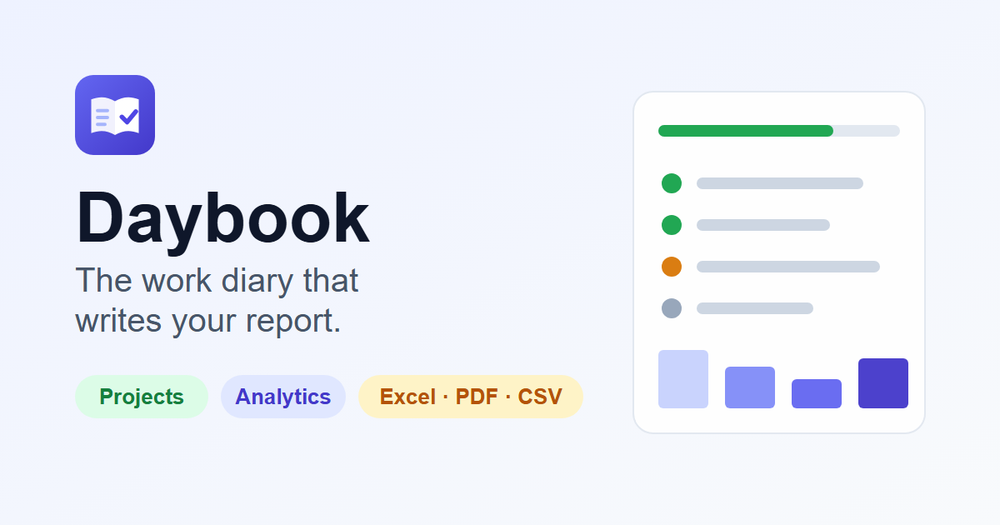

# Daybook

Daybook is a work diary for recording daily tasks, tracking progress, reviewing analytics, and producing reports. The frontend is an offline-capable web app; the backend provides accounts, personal-data sync, and team collaboration.

The application is split into two independently run projects:

- [`frontend/`](./frontend/) — React 19, Vite, and browser-based data storage.
- [`backend/`](./backend/) — Node.js, Express 5, MongoDB Atlas, and Socket.IO.

For detailed feature and implementation notes, see the [frontend README](./frontend/README.md) and [backend README](./backend/README.md).

## Frontend

The frontend is a single-page application with route-level code splitting. It provides:

- Day, week, month, board, and table task views, with quick-add, progress tracking, recurring work, and carry-forward threads.
- Projects, analytics dashboards, and daily, weekly, monthly, and custom reports.
- Import and export for common data formats, plus offline support as an installable Progressive Web App (PWA).
- Optional team projects with shared tasks, per-member progress, chat, notifications, and live presence. These features use the backend.

Personal task and project data is stored locally in the browser so the app can work offline. The API supports account access and syncing that data across devices.

### Run locally

```bash
cd frontend
npm install
cp .env.example .env
npm run dev
```

Open the Vite URL printed in the terminal (by default, <http://localhost:5173>). set `VITE_API_URL` in `frontend/.env` when the backend runs elsewhere. `VITE_SITE_URL` configures the public canonical and social URLs used for production builds.

Useful frontend commands (run from `frontend/`):

```bash
npm run build
npm run test
npm run lint
```

See the [frontend README](./frontend/README.md) before running its end-to-end suite; it starts the API and uses an Atlas `daybook_e2e` database that the teardown drops.

### Brand and app images

These are the existing assets under [`frontend/public/`](./frontend/public/), used by the browser tab, installed app, and social previews:

| Asset | Preview | Purpose |
|---|---|---|
| [`favicon.svg`](./frontend/public/favicon.svg) |  | Vector browser favicon |
| [`icons/favicon-32.png`](./frontend/public/icons/favicon-32.png) |  | 32 × 32 browser favicon |
| [`icons/apple-touch-icon.png`](./frontend/public/icons/apple-touch-icon.png) |  | 180 × 180 Apple home-screen icon |
| [`icons/icon-192.png`](./frontend/public/icons/icon-192.png) |  | 192 × 192 PWA icon |
| [`icons/icon-512.png`](./frontend/public/icons/icon-512.png) |  | 512 × 512 PWA icon |
| [`icons/icon-maskable-512.png`](./frontend/public/icons/icon-maskable-512.png) |  | 512 × 512 maskable PWA icon |
| [`og-image.png`](./frontend/public/og-image.png) |  | 1200 × 630 Open Graph and social preview image |

The editable SVG source artwork for the maskable and social preview images is in [`frontend/scripts/icons/`](./frontend/scripts/icons/). Regenerate all PNG icon and social-preview files with `cd frontend && node scripts/generate-icons.mjs`.

## Backend

The backend is an ES module Node.js service built with Express 5, Mongoose, MongoDB Atlas, and Socket.IO. Its API handles authentication, personal tasks and projects, day logs, settings, analytics, data sync, and team projects. It also provides validated API inputs, authentication middleware, and real-time events for data and collaboration updates.

### Configure and run locally

Prerequisites: Node.js 20+ and a MongoDB Atlas connection string. The backend requires Atlas and will reject a local MongoDB URI.

```bash
cd backend
npm install
cp .env.example .env
```

Set `MONGODB_URI` to your Atlas connection string (including a database name) and set `JWT_SECRET` to a random secret of at least 32 characters. In Atlas, allow connections from your development IP. Adjust `CLIENT_ORIGINS` if the frontend uses a different origin.

Then start the API:

```bash
npm run check:db
npm run dev
```

`GET /health` reports API and database status. In development, leave `SMTP_HOST` empty to write email previews to `backend/outbox/`. To send email, configure the SMTP variables in `backend/.env`.

Useful backend commands (run from `backend/`):

```bash
npm start
npm test
```

See the [backend README](./backend/README.md) for API routes, sync behavior, Socket.IO events, and test setup.
